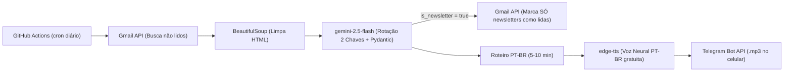

# 🎙️ Newsletter-to-Audio Serverless (Custo R$ 0,00)

Automação pessoal 100% serverless (roda diariamente na nuvem com o PC desligado) que lê e-mails não lidos no **Gmail**, filtra apenas **newsletters informativas** com **Gemini 2.5 Flash** (*Structured Outputs*), mantém e-mails pessoais intactos como não lidos, sintetiza um briefing em áudio neural em português (**5 a 10 min**) via **Edge-TTS** e envia o `.mp3` direto no **Telegram**.

---

## 🏗️ Arquitetura Serverless (R$ 0,00)



### Princípios Aplicados
- **Custo Zero Real:** Sem servidores pagos, sem OpenAI, sem Whisper/ElevenLabs. Usa apenas GitHub Actions (free tier), Google AI Studio (2 chaves gratuitas em rotação), Gmail API e `edge-tts`.
- **Economia de Tokens:** Limpeza determinística de HTML (`BeautifulSoup` + regex) antes de enviar ao LLM + `SQLitePromptCache` opcional para testes locais.
- **Triagem Segura:** Apenas mensagens classificadas como `is_newsletter=True` no schema Pydantic perdem a tag `UNREAD`.

---

## 🚀 Como Configurar e Rodar na Nuvem

1. **Clonar e instalar localmente (opcional para testes):**
   ```bash
   pip install -e .
   pytest -v
   ```
2. **Gerar o `GMAIL_REFRESH_TOKEN` (apenas 1 vez):**
   - Crie credenciais OAuth2 (Desktop App) no Google Cloud Console com a **Gmail API** ativada e salve como `credentials.json` na raiz.
   - Rode `python scripts/auth_gmail.py` e autorize no navegador.
3. **Configurar os *GitHub Secrets* no repositório:**
   - `GEMINI_API_KEY_1` e `GEMINI_API_KEY_2`
   - `GMAIL_CLIENT_ID`, `GMAIL_CLIENT_SECRET`, `GMAIL_REFRESH_TOKEN`
   - `TELEGRAM_BOT_TOKEN` e `TELEGRAM_CHAT_ID`
4. **Executar:**
   - O workflow `.github/workflows/daily_newsletter_podcast.yml` roda automaticamente todos os dias às **07h00 BRT** (`10:00 UTC`), ou manualmente pela aba **Actions -> Run workflow**.
